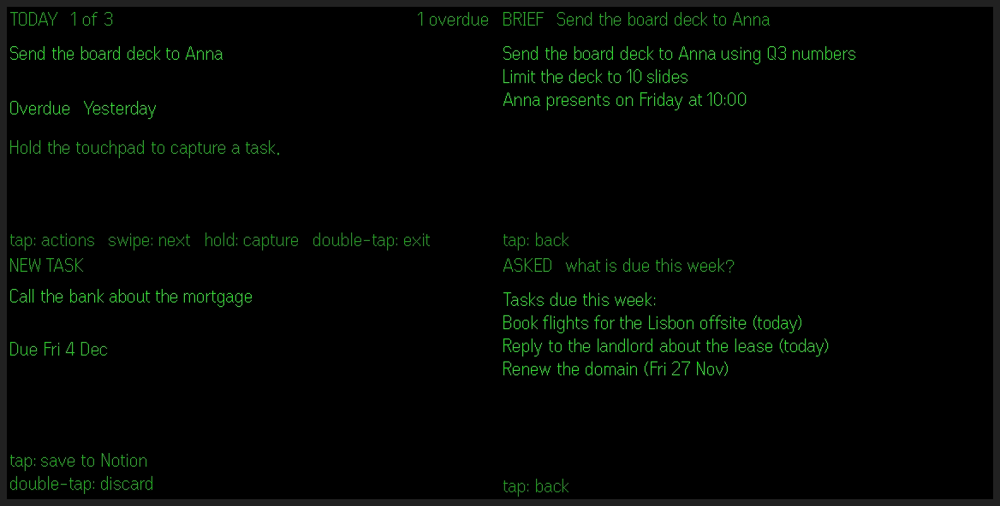

# Aside

**Your Notion tasks on Even G2: today at a glance, done with a tap, captured in one breath.**

The moment you remember something is rarely the moment you have a keyboard. Aside puts the task list you already keep in Notion on your glasses, and lets you add to it by saying one sentence: hold the touchpad, "send the deck to Anna on Friday", release. A model turns that into a clean task with a date, you see the draft, and a tap saves it.

Built for the Heads Up hackathon, track **AI Assistants & Work** (Notion, OpenRouter), with a Telegram bot as a second way in.



*Captured from the Even Hub simulator during the recorded demo run, against a real Notion workspace and a real model. [Watch the 66-second demo](docs/demo.mp4).*

## Read, then write

| You see | You do | What happens |
| --- | --- | --- |
| One task per card, overdue first | Swipe | Next task |
| A task | Tap, then pick **Done**, **Tomorrow** or **Next week** | The page is updated in Notion, in the way that database expects |
| A task | Tap, then **Brief me** | The task's page, cut down to a few lines that fit the display |
| Anything | Hold, say a task, release | A draft: title, due date and note. Tap saves it to Notion, double-tap discards it |
| Anything | Hold, ask a question, release | "What is due this week?" is answered in a few lines from your open tasks |

Nothing is written to Notion without a tap on a screen that shows exactly what will be written. Questions only read.

## From Telegram to your glasses

Half of what ends up on a to-do list arrives as a message. Forward it to your own Aside bot:

1. Someone writes "Can you send me the Q3 deck by Friday?". You forward it to the bot.
2. Within a second the draft is on your glasses, tagged `FROM TELEGRAM`, with who said it kept in the note.
3. Tap on the glasses, or press **Save to Notion** under the bot's reply. Either side decides, once: the other one updates ("Saved from your glasses").

Typing to the bot works the same way, and a question ("what is due this week?") is answered in the chat.

The bot is yours alone. It serves the one private chat that started it with the pairing code the relay prints, stops accepting codes after five wrong guesses, and says nothing to anyone else.

## What the model does, and what it is not trusted with

- It writes the **draft**: "remind me to call the bank next Friday about the mortgage" becomes *Call the bank about the mortgage, due Fri 4 Dec*.
- It writes the **brief** of a page.
- It **answers questions** about your open tasks. It is given the list and returns text; it has no way to change anything, and task titles are passed to it as data. With no model you get an honest summary instead: the counts and what comes first.
- Its draft is **checked before you see it**: the title cannot be empty, and the date is never taken on trust. A date you actually said ("on Friday", "1 Dec") is resolved by exact rules; the model's date is used only when the rules find none, and only if it is a real calendar date that is not in the past. If the model is down, slow or wrong, a rule-based parser produces the draft instead. That parser is also all you get if you configure no model, and it handles "tomorrow", weekdays, "next Friday", "in 2 weeks", "1 Dec", "by the end of the week".
- It never decides to save anything.

## Works with the task list you already have

No template to copy. Aside reads the schema of your database and works out which property is the title, which date is the due date, and how "done" is expressed: a checkbox, or a Status whose Complete group may be called anything. Completing a task sets that checkbox or moves the Status into its Complete group.

## Try it

**Without an account.** `npm install`, `npm run dev`, open the printed address. With no glasses and no relay the page runs on a built-in demo list: a green panel mirrors the display and four buttons stand in for the touchpad.

**In the simulator.** With the dev server running: `npm run simulate`.

**With a relay, still without an account.** `npm run relay:dev` starts the real relay and Notion client against an in-memory task list. On the phone page enter `http://localhost:8788` and the token `dev-token`.

**With your Notion.** Create a [personal access token](https://developers.notion.com/guides/connections-and-tokens/personal-access-tokens), then:

```bash
NOTION_TOKEN=ntn_... OPENROUTER_API_KEY=sk-or-... npm run relay
```

It prints a relay token. Enter the relay address and that token on the phone page under **Notion**. The relay finds your task list by itself, or you can pin one with `NOTION_DATA_SOURCE_ID`.

On real glasses the app runs inside the Even app on your phone, so `localhost` is the phone. Run the relay somewhere the phone can reach, and add that address to the `network` whitelist in `app.json` before `npm run pack`; the Even app only lets a plugin call hosts listed there.

| Variable | Required | Meaning |
| --- | --- | --- |
| `NOTION_TOKEN` | yes | Notion personal access token or internal connection token |
| `NOTION_DATA_SOURCE_ID` | no | The task list to use; otherwise the best match is found by search |
| `OPENROUTER_API_KEY` | no | Turns on model-written drafts, briefs and answers |
| `OPENROUTER_MODEL` | no | Default `anthropic/claude-haiku-5.5`; any OpenRouter model works. With no credits, `nvidia/nemotron-3-ultra-550b-a55b:free` did the job in the demo |
| `STT_URL`, `STT_KEY`, `STT_MODEL` | no | OpenAI-compatible transcription endpoint for voice capture |
| `TELEGRAM_BOT_TOKEN` | no | Token of a bot you created with @BotFather. Turns on capture from Telegram; the relay prints the `/start` code to pair with |
| `TELEGRAM_CHAT_ID` | no | Your chat id, printed after pairing. Set it to stay paired across restarts |
| `TZ_OFFSET_MINUTES` | no | Minutes ahead of UTC that decide what "today" is. Defaults to the time zone of the machine the relay runs on |

## The demo video is reproducible

`scripts/record.mjs` plays `scripts/story.json` (captions and touchpad actions) through the simulator's automation API, saves the glasses framebuffer after every step and builds the MP4 with ffmpeg:

```bash
npm run relay:dev        # or the real relay
npm run dev
evenhub-simulator "http://localhost:5173/?relay=dev&say=..." --automation-port 9898   # full address: "launch" in the story
npm run demo:record
```

Nobody can speak into an automated run, so each `say=` in the address stands in for one voice transcript. Everything after the transcript is the real path, and the video says so on screen.

## How it is built

```
src/core      task source interface, relay client, demo list, text layout
src/ui        pages (576x288 layouts), controller, display adapter, event mapping
shared/       date parsing, draft checking, telling a question from a task; used by the relay and the demo
server/       relay: Notion client, OpenRouter client, Telegram bot, HTTP API; Node built-ins only
test/         48 tests, run with `npm test`
```

- The Notion token, the model key and the speech key live only in the relay. The app holds a relay address and a relay token.
- The relay uses the Notion API version `2026-03-11` (data sources, Markdown page content).
- Layouts are data, measured with `@evenrealities/pretext` because the display font is proportional. A new screen is one `rebuildPageContainer`; a changed line is one `textContainerUpgrade`.
- Slow steps show a "working" screen and block further input, so a second tap cannot double-save.

## What has been tested, and how

- **Real Notion.** The relay ran against a live workspace on 24 November 2026 with a personal access token: it found the task list by itself (Notion's stock "Tasks" database: title, "Due date", a Status with a Complete group), listed what was due, created tasks, marked one done, moved one to tomorrow and read page content. Nothing in the client had to change after the first contact.
- **Real model.** Drafts, briefs and answers came from `nvidia/nemotron-3-ultra-550b-a55b:free` through OpenRouter, in well under a second each with reasoning switched off. The first live run showed why the model's dates are not trusted: another free model resolved "next Friday" to a Saturday. Since then a date the speaker actually said is always resolved by the rules, and the model's date is used only when the rules find none.
- **The simulator.** The whole demo story ran in the Even Hub simulator 0.9.5, driven through its automation API: list, swipe, brief, done, hold-to-capture, save, a question, move to tomorrow, the system menu. The app logged no errors. The captures above and the demo video come from that run.
- **Automated tests.** 48 of them: date parsing, schema detection, Notion request shapes, draft checking, the relay routes, layouts, every screen flow, the Telegram bot and the demo recorder. Two run the whole path over real HTTP against in-memory stand-ins for the Notion and Telegram Bot APIs.
- **Desktop Chrome**, on the demo list and against the dev relay with cross-origin requests.
- **Telegram, live.** On 24 November 2026 the relay ran with a real bot: pairing with the printed code, a refusal for a `/start` without it, a typed note that came back as a draft with the right Friday, **Save to Notion** pressed in Telegram and the page appearing in the Notion list, and a question ("what is due this week?") answered in the chat. The relay's inbox, which is what the glasses poll, held the draft until it was saved.
- **Packaging.** `npm run pack` type-checks, builds and stamps `aside.ehpk` (82 KB) with the Even Hub CLI for SDK 0.0.16.

Not done:

- **Telegram and the glasses at the same moment.** The live draft was confirmed from the Telegram side. Picking the same draft up in the simulator while the chat is open is covered by the end-to-end tests, not by a live run. Forwarded messages have also only been tested against the stand-in.
- **Live speech.** Voice capture has been exercised with scripted and mocked transcripts, not with a speech service.
- **Physical glasses.** Simulator only. The package has been built but not installed on a device.

## Hackathon notes

Everything in this repository was written during the hackathon week. Nothing existed before 23 November 2026. The display adapter and event mapping are shared with my other entry, Riskline, written the same week.

MIT licence.
